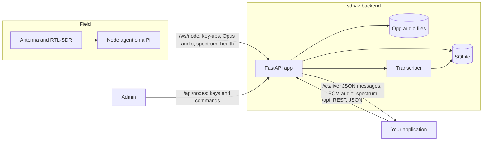

# sdrviz API

sdrviz records and transcribes railroad AAR radio heard by Raspberry Pi SDR receivers ("nodes"). The backend
(FastAPI) gives a browser, or any program you write, three things:

- a **REST API** under `/api` for frequencies, feeds and nodes, recordings, transit data and settings,
- a **live WebSocket** (`/ws/live`) that pushes key-ups, channel state, transcripts, train positions, audio and
  spectrum as they happen,
- a **node WebSocket** (`/ws/node`) that receiver nodes use to upload what they hear.

Production base URL used in the examples: `https://dispatch.andyvwhitman.com`. A development server defaults to
`http://localhost:8100`.

| Page | What it covers |
|---|---|
| [auth.md](auth.md) | Login, the session cookie, viewer and admin roles, lockout |
| [rest.md](rest.md) | Every REST endpoint with request and response examples |
| [live-websocket.md](live-websocket.md) | `/ws/live`: client ops, server messages, binary audio and spectrum frames, clock sync |
| [nodes.md](nodes.md) | Running or writing a node: enrollment, `/ws/node`, commands |
| [data-model.md](data-model.md) | Entities, fields and how they relate |

## System overview



Nodes decode the AAR channels assigned to them and send key-ups and audio. The server turns each transmission into
a live event, saves it as an Ogg Opus recording, and transcribes it. Your application reads the results over REST
and listens live over `/ws/live`.

FastAPI's interactive OpenAPI pages are at `/api/docs` and `/api/redoc`, and the schema is `/api/openapi.json`. (`/docs`
is this documentation, shown inside the app.)

## Conventions

**Format.** Requests and responses are JSON (`Content-Type: application/json`) unless a page says otherwise (audio
is `audio/ogg`, the waterfall backfill is raw bytes, GeoJSON layers are `application/geo+json`). Field names are
`snake_case`. Unknown JSON fields in a request body are ignored.

**Ids.** All ids are strings except recordings (integer). Frequencies use slugs such as `amtk-nec-road`. Feeds are
`feed-...` (replay data) or `node-<number>` (a real node, for example `node-1`). Node ids are `node-` plus eight
random characters (`node-49m0vfe5`); the node *number* (1 to 65535) is what makes up its feed id. AAR channels are
integers 1 to 97 (channel 1 is 160.125 MHz, 15 kHz steps).

**Time.** There are three kinds of time.

| Kind | Where | Form |
|---|---|---|
| Wall clock | Recording `started_at`, activity buckets, node `created_at` and `last_seen`, transit | ISO 8601. Recordings use UTC with a `Z` and milliseconds (`2026-11-17T19:20:04.517Z`). Node and transit times carry an offset. |
| Server clock "day offset" | Live messages: `t`, `now`, `clock`, `t_offset_s`, `end_t` | Seconds after midnight, Eastern time (America/New_York), in `[0, 86400)`. It wraps at midnight. `clock` is the same as `HH:MM:SS`, `clock_tenths` as `HH:MM:SS.s`. |
| Node epoch | Node protocol only | Milliseconds since 1970 |

The server clock is the one clock that matters in live data. In **replay mode** (`sim: true` in the snapshot and in
`GET /api/system`) the server plays back a recorded day (2026-11-10) in a loop, and the clock can be jumped or sped
up with `POST /api/sim/jump`; the "day" repeats. With the replay off, the clock is the real Eastern time of day at
1x speed and cannot be moved. Either way the day offset only identifies a moment within a day; for a calendar time
use the recording `started_at`. See [live-websocket.md](live-websocket.md#clock-sync).

**Errors.** Errors are JSON with a `detail` field and an HTTP status.

| Status | Meaning | Body |
|---|---|---|
| 401 | No valid session | `{"detail": "Not authenticated"}` (login failure: `"Wrong password"`) |
| 403 | Viewer used an admin endpoint, or cross-origin browser request | `{"detail": "Admin only"}` or `{"detail": "Cross-origin request refused"}` |
| 404 | Unknown id | `{"detail": "No frequency 'x'"}` |
| 409 | State does not allow it (duplicate id, no fault to acknowledge, node not online) | `{"detail": "..."}` |
| 410 | Recording audio has expired | `{"detail": "..."}` |
| 422 | Validation | a string `detail` for checks written by hand, otherwise FastAPI's list form (below) |
| 423 / 429 | Login lockout / rate limit | `{"detail": "..."}` plus a `Retry-After` header (seconds) |
| 503 | Transit is turned off (some `/api/transit` calls) | `{"detail": "transit is turned off"}` |

FastAPI validation errors look like this:

```json
{"detail": [{"type": "missing", "loc": ["body", "id"], "msg": "Field required", "input": {}}]}
```

A client should accept `detail` as either a string or a list.

**Roles.** There are two: `viewer` (read, listen, change your own view) and `admin` (everything else). Every `/api`
endpoint except `/api/auth/*` needs a session. See [auth.md](auth.md).

## Quick start

Log in and keep the cookie:

```sh
curl -c cookies.txt -X POST https://dispatch.andyvwhitman.com/api/auth/login \
  -H 'Content-Type: application/json' -d '{"password": "YOUR_PASSWORD"}'
# 204 No Content, and a Set-Cookie: sdrviz_session=...

curl -b cookies.txt https://dispatch.andyvwhitman.com/api/auth/session
# {"authenticated":true,"sim":true,"role":"viewer"}
```

List frequencies (each shows the feeds it is assigned to):

```sh
curl -b cookies.txt https://dispatch.andyvwhitman.com/api/frequencies
```

Fetch the newest recordings, then one recording's audio:

```sh
curl -b cookies.txt 'https://dispatch.andyvwhitman.com/api/recordings?limit=5'
curl -b cookies.txt -o 412.ogg https://dispatch.andyvwhitman.com/api/recordings/412/audio
```

Read the live state once (the same object the socket sends as `snapshot`):

```sh
curl -b cookies.txt https://dispatch.andyvwhitman.com/api/live/state
```

Open the live socket from Python (`pip install httpx websockets`):

```python
import asyncio
import json

import httpx
import websockets

BASE = "https://dispatch.andyvwhitman.com"


async def main() -> None:
    client = httpx.Client(base_url=BASE)
    client.post("/api/auth/login", json={"password": "YOUR_PASSWORD"}).raise_for_status()
    cookie = "; ".join(f"{name}={value}" for name, value in client.cookies.items())

    async with websockets.connect(
        BASE.replace("https", "wss", 1) + "/ws/live", additional_headers={"Cookie": cookie}
    ) as ws:
        async for frame in ws:
            if isinstance(frame, bytes):
                continue  # binary audio and spectrum frames, see live-websocket.md
            message = json.loads(frame)
            if message["type"] == "keyup":
                print(message["clock_tenths"], message["aar"], message["feed_id"], message["speaker"])
            elif message["type"] == "keydown":
                print("  ended after", message["duration_s"], "s")


asyncio.run(main())
```

On older `websockets` releases (before 14) the keyword is `extra_headers` instead of `additional_headers`.

## Things to know before you build

- **Browser-origin check.** A request with an `Origin` header (a browser page) must name the site's own host or the
  server's public address, or it is refused (403 for `POST`, `PUT`, `PATCH`, `DELETE`; the handshake is closed for a
  WebSocket). Programs that send no `Origin` header (curl, httpx, `websockets`) are not affected. Reads (`GET`) are
  never checked.
- **No push for stored data.** `/ws/live` carries what is happening now. New recordings and finished transcripts are
  read with `GET /api/recordings`; poll it (see [rest.md](rest.md#recordings)).
- **No pagination token other than time.** Recordings page with `before=<started_at of the last row>`.
- **Versions.** The API has no version prefix. The WebSocket `hello` carries `protocol` (currently `1`) and the node
  protocol has its own `protocol: 1`.
