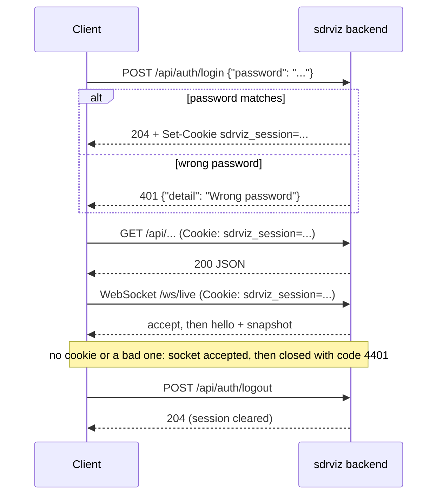

# Authentication and roles

sdrviz uses one shared password per role and a signed session cookie. There are no user accounts, API tokens or
OAuth. Receiver nodes do not use this at all; they have their own credentials ([nodes.md](nodes.md)).

## Auth flow



## Endpoints

These three are the only `/api` calls that work without a session.

### `POST /api/auth/login`

Body: `{"password": "YOUR_PASSWORD"}` (at most 256 characters). Answers `204 No Content` and sets the cookie.

| Status | When |
|---|---|
| 204 | Password accepted; the role is in the cookie |
| 401 | `{"detail": "Wrong password"}` |
| 422 | Body is not `{"password": <string>}` |
| 429 | Too many wrong passwords recently. `Retry-After` gives the seconds to wait. |
| 423 | Locked out after repeated wrong passwords. `Retry-After` gives the seconds left. |

### `POST /api/auth/logout`

Clears the session cookie. Always `204`.

### `GET /api/auth/session`

Works with or without a session. Use it to find out who you are.

```json
{"authenticated": true, "sim": true, "role": "viewer"}
```

| Field | Type | Meaning |
|---|---|---|
| `authenticated` | bool | A valid session cookie was sent |
| `role` | `"viewer"`, `"admin"` or `null` | `null` when not logged in |
| `sim` | bool | Always `true` in the current code, whatever the server mode. Do not rely on it; use `sim` in `GET /api/system` or in the live snapshot. |

## The cookie

| Property | Value |
|---|---|
| Name | `sdrviz_session` |
| Content | Signed (Starlette `SessionMiddleware`), body is base64 JSON such as `{"user": "viewer"}`. Signed, not encrypted. |
| Lifetime | 14 days (`Max-Age=1209600`), `HttpOnly`, `SameSite=Lax`, `Secure` on an `https://` deployment |
| Scope | `/` |

Sessions are stateless: logout only asks the client to drop the cookie. A copy of the cookie stays valid until it
expires or the server's secret changes. Non-browser clients should store the `Set-Cookie` value and send it as a
`Cookie` header, including on the WebSocket handshake.

## Roles

The server has a viewer password and, optionally, an admin password (`SDRVIZ_PASSWORD`, `SDRVIZ_ADMIN_PASSWORD`).
The role is decided by which password you send.

- Both passwords set: the viewer password logs in as `viewer`, the admin password as `admin`.
- Only the viewer password set: it logs in as `admin` (single-password mode). Everyone is an admin.

### What a viewer may do

- Every `GET` under `/api` except those listed below as admin only.
- Open `/ws/live` and use all of its client ops, including `listen`, `audio`, `watch`, and hold-to-listen
  (`listen_hold`, `listen_release`). Choosing which node you listen to is per connection and changes nothing shared.
- `PUT` and `PATCH /api/prefs`.
- `POST /api/feeds/{id}/ack` (acknowledge a feed fault).

### What only an admin may do

| Area | Calls |
|---|---|
| Frequencies | `POST /api/frequencies`, `POST /api/frequencies/from-channel`, `PUT` and `DELETE /api/frequencies/{id}`, `PUT` and `DELETE /api/frequencies/{id}/assignments/{feed_id}` |
| Feeds | `POST /api/feeds`, `PUT` and `DELETE /api/feeds/{id}` |
| Nodes | everything under `/api/nodes`, including the GET calls |
| Receiver | `GET` and `PUT /api/radio/settings` |
| Replay clock | `POST /api/sim/jump` |
| Transit sources | `GET`, `POST`, `PUT`, `DELETE` under `/api/transit/sources`, and `POST /api/transit/sources/{id}/refresh` |

Every one answers `403 {"detail": "Admin only"}` to a viewer and `401` without a session.

## Rate limiting and lockout

Wrong passwords are counted per client address, in memory (lost on restart).

| Rule | Result |
|---|---|
| 5 wrong passwords within 60 s | `429` until the oldest of them is 60 s old |
| 15 wrong passwords within 15 min | `423` for 15 min |
| A correct password | Clears the client's count |

Behind a reverse proxy the "client address" is whatever the server sees; it is only the real client when the
server runs with proxy headers enabled.

## WebSocket authentication

`/ws/live` reads the same cookie. The server accepts the connection first and then closes it with code `4401` if the
cookie is missing or invalid, so a client can tell "not logged in" from a network error. A browser-style `Origin`
header that does not match the site closes the handshake (code 1008). `/ws/node` does not use the cookie; see
[nodes.md](nodes.md#authentication).
