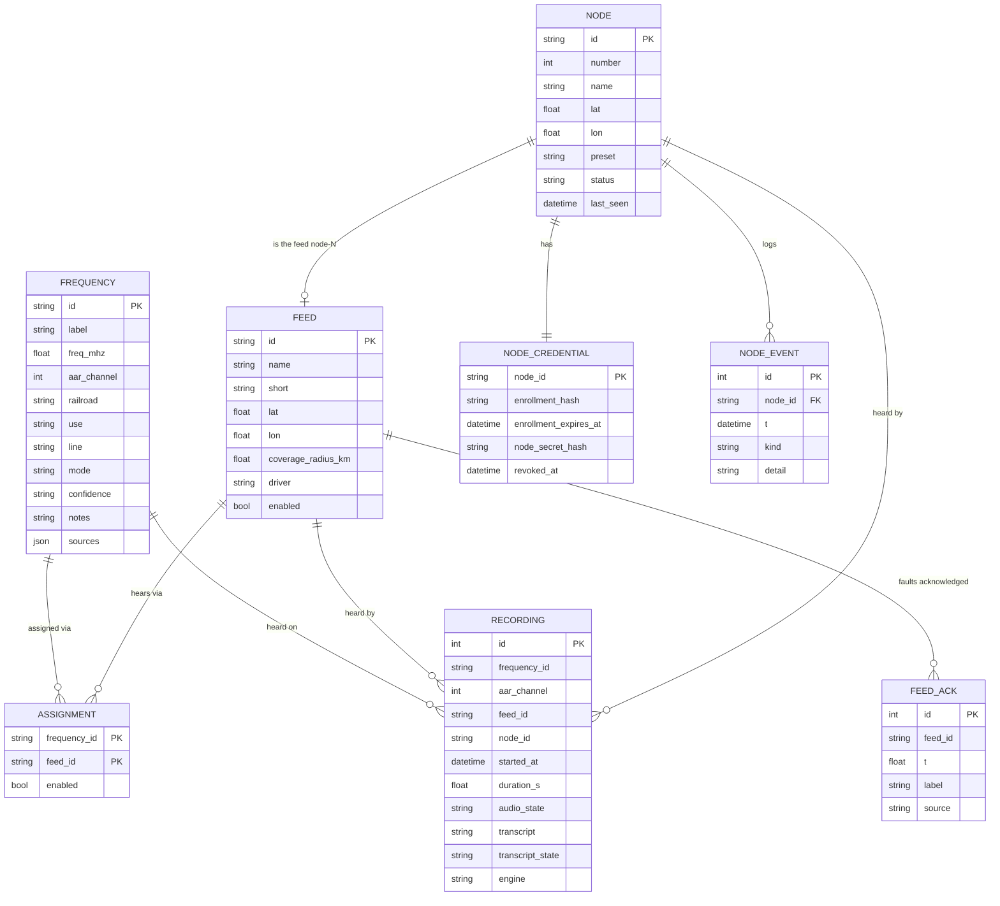

# Data model

The server keeps its data in SQLite. This page lists the entities an API user meets and how they relate. Names are
the table names in the code (`backend/app/models.py`, `nodes/models.py`, `recordings/models.py`); the JSON field
names in the API match the columns unless noted.

## Relationships

Things the diagram cannot show:

- **No foreign keys on recordings.** `Recording.frequency_id`, `feed_id` and `node_id` are plain strings. Deleting a
  frequency or feed leaves its recordings in place.
- **Node feeds are derived.** A `NODE` is also a feed, with id `node-<number>`, but that feed is not a row in the
  `feed` table: it is built from the node row when the server loads its world. Stored `FEED` rows are replay and
  manually created feeds (`PUT`/`DELETE /api/feeds/{id}` act only on those).
- **Transcripts are not a table.** A transcript is the `transcript` text and `transcript_state` of a recording.
- **Replay transmissions** (`transmission`, the recorded day that is played back in replay mode) are a separate
  table, not exposed through `/api/recordings`. They appear in live messages and snapshots with `sim: true`.

## Frequency

Table `frequency`. A radio channel the system knows about.

| Field | Type | Notes |
|---|---|---|
| `id` | string | Primary key, a slug such as `amtk-nec-road` |
| `label` | string | Short display name |
| `freq_mhz` | float | Centre frequency |
| `aar_channel` | int | 1 to 97 for the AAR band: `round((freq_mhz - 160.110) / 0.015)`, so channel 1 is 160.125 MHz and 97 is 161.565 MHz |
| `railroad`, `use` | string | Owner and purpose, such as `Amtrak`, `road/dispatcher` |
| `line` | string | Line or territory text |
| `mode` | string | Modulation, `NFM` by default |
| `confidence` | string | How sure the listing is |
| `notes` | string | |
| `sources` | string[] | URLs |

## Assignment

Table `assignment`, primary key `(frequency_id, feed_id)`. Joins a frequency to a feed.

| Field | Type | Notes |
|---|---|---|
| `frequency_id` | string | |
| `feed_id` | string | A feed id, which must exist in the world when the assignment is made |
| `enabled` | bool | A feed receives, shows live and records exactly its **enabled** assignments |

An unassigned or disabled frequency is not decoded, shown or recorded on that feed. Held listens
([live-websocket.md](live-websocket.md#hold-to-listen)) add a channel to a node temporarily without an assignment.

## Feed

Table `feed` (stored feeds) and the node-derived feeds. One receiving site.

| Field | Type | Notes |
|---|---|---|
| `id` | string | `feed-...` or `node-<number>`; `feed-live` is the LAN `rtl_tcp` receiver |
| `name`, `short`, `site` | string | `short` is derived from the name when omitted (for example `LND-02`) |
| `lat`, `lon` | float | Position |
| `coverage_radius_km` | float | Used for coverage display |
| `hears` | string[] | Output only: ids of the frequencies enabled on this feed |
| `driver` | string | `rtl_tcp`, `sdrviz-agent`, `file` |
| `host`, `port` | string, int | For `rtl_tcp` |
| `center_mhz`, `sample_rate_msps`, `gain_db`, `ppm`, `noise_floor_dbfs` | float | Tuning and nominal readings |
| `enabled`, `sim` | bool | `sim` marks replay feeds |
| `state`, `label`, `acked` ... | | Live health, computed: see [rest.md](rest.md#the-feed-object) |

## Node

Table `node`, with `node_credential` (SHA-256 hashes only) and `node_event`.

| Field | Type | Notes |
|---|---|---|
| `id` | string | `node-` plus 8 characters |
| `number` | int | Unique, 1 to 65535 |
| `name`, `lat`, `lon` | | |
| `preset` | string | `assigned` or `aar` |
| `status` | string | Stored as `PENDING`, `OFFLINE` or `REVOKED`; `ONLINE` is computed from the live socket |
| `created_at`, `last_seen`, `agent_version` | | |

Full object and calls: [nodes.md](nodes.md#the-node-object).

## Recording

Table `recording`. One saved transmission; kept forever, only the audio file expires.

| Field | Type | Notes |
|---|---|---|
| `id` | int | Primary key |
| `frequency_id`, `aar_channel` | string, int | What was heard. `frequency_id` may name a frequency that has since been deleted |
| `feed_id` | string | The feed that heard it (`node-1`) |
| `node_id` | string or null | The node row id; null for the LAN receiver |
| `feed_lat`, `feed_lon` | float or null | Receiver position at the time |
| `started_at` | datetime | UTC, returned as `...Z` with milliseconds |
| `duration_s` | float | |
| `audio_bytes` | int | |
| `audio_state` | string | `ok` or `expired` (`audio_url` is then null) |
| `transcript` | string | Text |
| `transcript_state` | string | `pending`, `done`, `empty`, `failed` |
| `engine` | string | Transcriber, such as `faster-whisper:small.en` |

The API adds `audio_url` (`/api/recordings/{id}/audio`, or null). The server-side file path is not exposed. Audio is
Ogg Opus; the retention limit is set by the server (default 90 days or 10 GB, whichever bites first).

## Other stored data

| Entity | Notes |
|---|---|
| `feed_event`, `feed_ack` | Replay health timeline, and acknowledged faults (`source` is `sim` or `user`). Acknowledge through `POST /api/feeds/{id}/ack` |
| `prefs` | Unused. A single row left over from when mute, solo, record and volume were shared; they now live in each browser, and no API reads or writes the table |
| `receiver` | The single LAN `rtl_tcp` receiver settings ([rest.md](rest.md#receiver-settings)) |
| `transit_source`, `transit_meta`, `station_groups`, `station_members` | Transit data sources and station merge groups ([rest.md](rest.md#trains-and-transit)). `api_key` is never returned |

## Live objects (not stored)

Channels, transmission rows, trains and fault summaries that the live socket carries are built from the tables
above and the replay or node traffic; their fields are in [live-websocket.md](live-websocket.md#snapshot).
