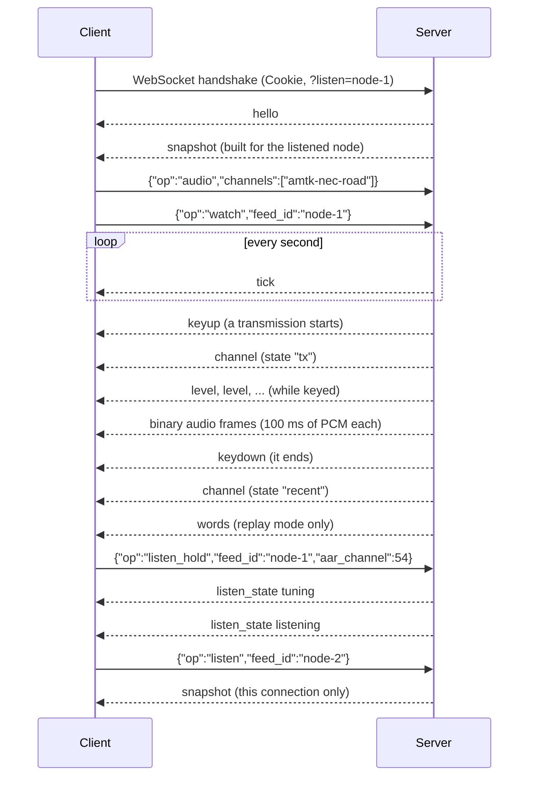
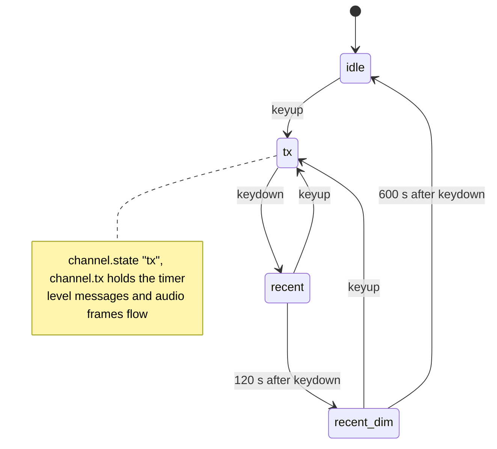
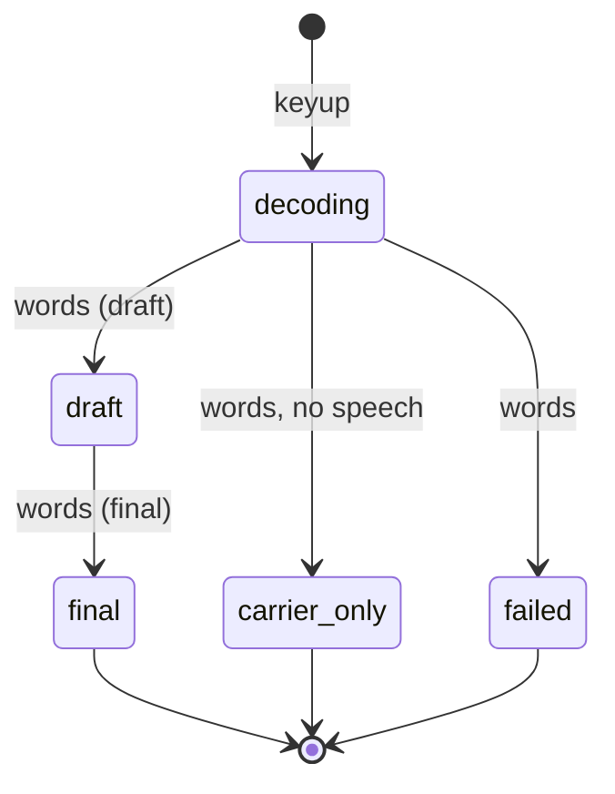

# Live WebSocket: `/ws/live`

One WebSocket carries everything that happens in real time: key-ups, channel state, level meters, transcripts,
fault changes, train positions, and (on request) audio and spectrum. Text frames are JSON objects with a `type`;
binary frames are audio or spectrum.

- URL: `wss://dispatch.andyvwhitman.com/ws/live` (`ws://localhost:8100/ws/live` for a dev server)
- Auth: the `sdrviz_session` cookie on the handshake ([auth.md](auth.md)). Any role may connect and use every op.
- Optional query: `?listen=<feed_id>` chooses the node this connection shows ([listen](#listen)).

## Message flow



On connect the server sends exactly two messages first, in this order: `hello`, then `snapshot`. Apply the snapshot
as your baseline and update it with the deltas that follow.

## Modes: replay and live

The server runs in one of two modes, reported by `sim` in the snapshot.

- **Replay** (`sim: true`): a recorded day is played back in a loop, with synthetic audio and transcripts. All
  message types below are sent.
- **Live** (`sim: false`, real nodes only): there is no replay engine. Per the code, then only `hello`, `snapshot`,
  `tick`, `keyup`, `keydown`, `level`, `channel`, `listen_state`, `pong`, binary frames, and fresh `snapshot`s after
  shared changes (assignments, frequencies, nodes, receiver settings) are sent. `words`, `trains`, `lofar_row`,
  `feed`, `faults` and the 30-second snapshot keyframe come from the replay engine and are not produced. A live
  key-up row has `state: "not_recorded"`; read transcripts from `GET /api/recordings` instead
  ([rest.md](rest.md#recordings)).

Write clients to ignore message types they do not know and fields they do not use.

## Client ops

Send each as a JSON text frame: `{"op": "<name>", ...}`. A malformed frame (not JSON, not an object, no string `op`) or an unknown op is
answered with one [`error`](#error) message and the socket stays open. Bad field values on a known op are
**ignored without a message** (except where `listen_state` says otherwise).

| Op | Fields | Effect |
|---|---|---|
| `listen` | `feed_id` | Show this node: the server answers with a new `snapshot` for it, to this connection only |
| `audio` | `channels`: frequency ids | Replaces the set of frequencies whose audio you want. Unknown ids are dropped. `[]` stops audio |
| `watch` | `feed_id` or `null` | Receive spectrum frames of that feed. One feed per connection; `null` or an unknown id stops them |
| `listen_hold` | `feed_id`, `aar_channel` | Hold-to-listen: hear an AAR channel on a node even if it is not assigned |
| `listen_release` | `feed_id?`, `aar_channel?` | End a hold. No fields: release all of this connection's holds |
| `ping` | none | Server answers `{"type":"pong","t":<server day offset>}` |

### Listen

The node a connection shows belongs to the connection, not the user. Choose it with `?listen=<feed_id>` on the URL or
the `listen` op. An unknown or missing id means the default: the first online node, else the first feed. The
resolved choice is `state.listen_feed` in the snapshot. The channel list in a snapshot (the tiles) is the listened
node's enabled frequencies, sorted by frequency. Everything else is shared by all connections.

### Audio

`audio` takes **frequency ids** (`amtk-nec-road`) and each subscribed frequency is delivered from whichever node
hears it, not only the listened one. See [audio frames](#audio-frame) for the bytes. Audio starts at the next 100 ms chunk after you subscribe, so a transmission already in progress reaches you
without its first chunk (no `first` flag).

### Hold to listen

Lets you hear a channel that is not assigned to a node.

- `feed_id` must be an online node feed (`node-N`); `aar_channel` 1 to 97. Send the op when the user presses and
  again **every 5 seconds** while held. The server drops a hold after 15 seconds without a renewal, on release, or on
  disconnect.
- At most 4 holds per connection.
- While held, the channel is added to that node's decode list. Audio arrives as ordinary binary audio frames (the AAR
  channel is in the header) to the holding connections only. It is never recorded, transcribed, nor announced with
  `keyup`, `keydown`, `level` or a tile. If the channel is also a frequency you subscribed to with `audio`, you get
  the audio once.
- Bad field types or an out-of-range channel are ignored silently. A hold on a feed that is not a node or that is
  offline is answered with `listen_state` `failed`.
- A repeat of a held `(feed_id, aar_channel)` only renews it and sends no message.

## Server messages

Common to all: `type`. Times named `t`, `now` and `end_t` are the [server clock](#clock-sync) in seconds after
Eastern midnight.

### `hello`

```json
{"type": "hello", "protocol": 1,
 "sim": {"scenario": "keyed", "speed": 1.0, "clock_s": 50866.26, "clock": "14:07:46"},
 "server_time": "2026-11-21T00:21:53.910+00:00"}
```

`protocol` is the WebSocket protocol version. `sim.scenario` is `null` unless a replay scenario is active.
`server_time` is real UTC wall time.

### `snapshot`

`{"type": "snapshot", "state": {...}}`. The complete state for this connection. Sent on connect, after a `listen`
op, and, to every connection (each built for the node it listens to), after shared changes: assignments,
frequencies, feeds and nodes, receiver settings, a clock jump, an acknowledged fault, and in replay mode every 30 s.
It is the same object as `GET /api/live/state`.

| Field | Type | Meaning |
|---|---|---|
| `scenario` | string or null | Active replay scenario |
| `sim` | bool | Replay mode |
| `speed` | number | Clock speed (1 normal, 0 frozen) |
| `date`, `tz` | string, object | `date` is the recorded day in replay mode, today (Eastern) otherwise. `tz` is `{name, iana, utc_offset}` |
| `t_offset_s`, `clock`, `clock_tenths` | number, string | Server clock now (day offset, `HH:MM:SS`, `HH:MM:SS.s`) |
| `listen_feed` | string or null | The node the `channels` list was built for |
| `feeds_listenable` | array | `{feed_id, name, short, online}` for every feed (a node picker). `online` means state `ok` or `stale` |
| `displayed_feed_admin`, `displayed_feed_admin_why` | string | The feed the Feeds page inspects first, and why |
| `header`, `status_line`, `faults`, `degraded` | | Health summary, same as the [`faults`](#faults) message |
| `feeds` | array | Feed objects ([rest.md](rest.md#the-feed-object)) |
| `system` | object | `host`, `decoder`, `disk` readings |
| `channels` | array | One per frequency enabled on `listen_feed`, ordered by `freq_mhz` (below) |
| `active_transmissions` | array | Transmission rows currently keyed, each with `elapsed_s` and `receptions` |
| `transcript` | object | `{rows: [row...], count_today}`; `rows` is up to 40 recent transmissions, newest first. Not filtered by node; each row has `feed_id` |
| `trains` | object | `{tracked_count, positions}` (replay trains) |
| `ctc` | object | Per route: `{trains, detectors_talking}` |
| `lofar_60m` | object | `{row_s, rows, row0: "newest", cells}`; `cells[feed_id][aar] = [[row, dbfs], ...]`, row 0 newest |

A **channel** object:

```json
{"id": "amtk-nec-road", "label": "AMTK NEC", "aar": "CH54", "aar4": "5454", "freq_mhz": 160.92,
 "railroad": "Amtrak", "use": "road/dispatcher", "monitored": true, "heard_by": ["feed-alx", "feed-lnd"],
 "coverage": {"state": "ok", "healthy": 4, "total": 4, "label": null,
              "pips": [{"feed_id": "feed-alx", "short": "ALX-01", "state": "ok"}]},
 "state": "recent", "status_readout": "LAST 4M", "channel_fault": null, "tx": null,
 "last_heard": {"tx_id": "sim-0652", "end_t": 50867.3, "clock": "14:07:46", "age_s": 0.1, "age_label": "0S", "via": "BWI-03"},
 "spark_60m": [0.0, 1.3]}
```

`state` is one of `idle`, `squelch`, `tx`, `recent` (ended under 120 s ago), `recent-dim` (under 600 s ago).
`spark_60m` is airtime in seconds per minute over the last hour (60 bins).

A **transmission row** (in `active_transmissions`, `transcript.rows` and `keyup.row`):

| Field | Notes |
|---|---|
| `id` | Transmission id (`sim-0653`, `live-5`) |
| `t_offset_s`, `clock`, `clock_tenths` | Start, server clock |
| `aar`, `aar4`, `frequency_id`, `label` | Channel (`CH54`, `5454`) and frequency |
| `feed_id`, `feed_label` | Primary feed and its short name (`BWI-03 +1` when several heard it) |
| `role`, `role_tag`, `speaker`, `train_id`, `place_id` | Who spoke, in replay mode; `unknown`/`null` for live key-ups |
| `duration_s` | Final length; `0.0` while a live one is still keyed |
| `state` | `decoding`, `draft`, `final`, `carrier_only`, `no_transcript_decoder_down`, `failed`, `undecodable`, `not_recorded` |
| `final_state` | The state it will settle in |
| `live` | Still keyed |
| `transcript`, `words`, `confidence`, `detector` | `words` is `[{w, conf, t?}]`; `detector` is a defect-detector reading or `null` |
| `receptions` | `[{feed_id, snr_db, rssi_dbfs, dist_km?}]` per feed that heard it |
| `sim` | `true` for replay data |

### `tick`

```json
{"type": "tick", "t": 50866.37, "clock": "14:07:46", "clock_tenths": "14:07:46.4", "speed": 1.0}
```

Once a second, in every mode. This is the server clock; see [clock sync](#clock-sync).

### `keyup`

A transmission began.

```json
{"type": "keyup", "tx_id": "sim-0653", "tx_seq": 10, "channel_id": "csx-rfp-road", "aar": "CH96",
 "feed_id": "feed-alx",
 "receptions": [{"feed_id": "feed-alx", "snr_db": 9.3, "rssi_dbfs": -37.7, "dist_km": 29.1}],
 "role": "detector", "role_tag": "DET", "speaker": "CSX detector Neabsco", "train_id": "VRE 301",
 "place_id": "det-neabsco", "t": 50872.1, "now": 50872.12, "clock_tenths": "14:07:52.1",
 "row": {"id": "sim-0653", "state": "decoding", "...": "a transmission row"}}
```

`t` is the start. `now` is the server clock when the message was sent (equal to `t` for live key-ups; in replay mode
it can be slightly later). `tx_seq` is the number in the audio frames' header. Key-ups are sent for every enabled frequency
on every node (not only the listened node), so filter by `channel_id` or `feed_id` if you want one node. The first
node to key up a channel owns it until its keydown; a second node hearing the same transmission appears only in
`receptions`.

### `keydown`

`{"type":"keydown","tx_id":"sim-0652","channel_id":"amtk-nec-road","duration_s":1.3,"t":50867.3}`

The transmission ended. `t` is the **end** time (start plus `duration_s`). When a node drops, its keyed
transmissions are ended with a `keydown`.

### `channel`

A patch for one channel, by `id`:

```json
{"type": "channel", "id": "amtk-nec-road", "state": "recent", "tx": null,
 "last_heard": {"tx_id": "sim-0652", "end_t": 50867.3, "clock": "14:07:46", "age_s": 0.1, "age_label": "0S", "via": "BWI-03"},
 "coverage": {"...": "as in the snapshot"}, "channel_fault": null, "status_readout": "LAST 0S"}
```

Merge the keys present into the channel you hold; ignore a `channel` whose `id` is not in your `channels` (patches go
out for every frequency, whichever node you listen to). Not every key is always present: live-receiver patches may
omit `coverage`. A `status_readout` that starts with `LAST` is a label; count the age yourself from
`last_heard.end_t`. Sent on key-up, key-down, and when a channel's state changes (checked once a second).

### `level`

`{"type":"level","t":50866.27,"levels":{"amtk-nec-road":{"db":-15.1,"peak":-15.1}}}`

Signal level in dBFS of the keyed channels (frequency id to `{db, peak}`). Several times a second while any channel
is keyed; not sent when nothing is.

### `words`

`{"type":"words","tx_id":"sim-0652","state":"final","words":[{"w":"clear","conf":0.97}],"transcript":"clear signal","confidence":0.93,"detector":null}`

Decoder progress for a transmission: first `draft` (without confidence), then `final`; other outcomes
(`carrier_only`, `failed`, `undecodable`, `no_transcript_decoder_down`) are sent once. **Replay mode only.** For
real traffic use the recording's `transcript` ([rest.md](rest.md#recordings)).

### `feed`

`{"type":"feed","feed_id":"feed-lnd", ...}` plus the feed fields from [rest.md](rest.md#the-feed-object) except
`id`. Sent when a feed's state changes, and when its readouts that move change (replay mode).

### `faults`

```json
{"type": "faults", "faults": [{"object": "feed-lnd", "kind": "feed", "short": "LND-02", "state": "fault",
   "label": "FAULT · LINK LOST", "since": "14:06:00", "acked": false, "acked_at": null}],
 "degraded": [{"object": "feed-bay", "kind": "feed", "short": "BAY-04", "state": "stale", "label": "STALE",
   "since": "14:06:20", "in_state_label": "1M 12S"}],
 "header": {"feeds_chip": "FEEDS 3/4", "feeds_chip_state": "fault", "feeds_hero": "FEEDS NOMINAL 3/4 ..."},
 "status_line": ["LND-02 · FAULT · LINK LOST · SINCE 14:06:00"]}
```

The full fault summary. Sent when the set of non-ok feeds or their acknowledgement changes (replay mode).

### `trains`

`{"type":"trains","positions":[...],"ctc":{...}}`, once a second (replay mode). `positions` entries are the same as
`GET /api/trains/live`.

### `lofar_row`

`{"type":"lofar_row","t":50850,"cells":{"feed-lnd":{"amtk-nec-road":-35.2}}}`. One row per 30 s (replay mode):
strongest reception per feed and frequency in dBFS.

### `listen_state`

To the holding connection only: `{"type":"listen_state","feed_id":"node-1","aar_channel":54,"state":"tuning"}`.

| `state` | Meaning |
|---|---|
| `tuning` | Hold accepted; the node was sent the new channel list |
| `listening` | The node confirmed it decodes the channel. Sent at once, without `tuning`, when the node already did. The first audio frame comes with the next transmission |
| `released` | The hold ended. `reason` is `"released"` (your op) or `"timeout"` |
| `failed` | The hold is gone. `reason`: `"not a node"`, `"node offline"`, `"too many holds"`, `"node timeout"`, `"node failed"`, `"could not tell the node"`. Send the op again to retry |

### `pong`

`{"type":"pong","t":50866.27}`, the answer to `ping`; `t` is the server clock.

## Errors

### `error`

`{"type":"error","op":"dance","detail":"unknown op"}`, the answer to a client frame the server cannot act on. `op` is the op name that was sent, or `null` when there was none (malformed JSON, no `op`, or an `op` that is not a string). `detail` is `"unknown op"` or `"expected a JSON object with an op"`. The connection is not closed and later ops work. Clients should log it and move on; a client that does not know the `error` type should ignore it like any other unknown message type.

## Binary frames

Binary frames are big-endian. The first byte is the kind.

### Audio frame

12-byte header, then the payload.

| Offset | Size | Field |
|---|---|---|
| 0 | 1 | `kind` = 1 |
| 1 | 1 | `codec`: 0 = PCM (always, on `/ws/live`) |
| 2 | 1 | `aar_channel` (1 to 97) |
| 3 | 1 | `flags`: bit 0 (`0x01`) first chunk of the transmission, bit 1 (`0x02`) last |
| 4 | 4 | `tx_seq`: matches `keyup.tx_seq`. For real nodes it is the server's own counter (2 000 000 001 and up) |
| 8 | 4 | `offset_ms`: start of this chunk since the key-up (0, 100, 200, ...) |
| 12 | n | Payload: signed 16-bit little-endian PCM, mono, **8000 Hz**. A chunk is 100 ms = 1600 bytes (the last may be shorter) |

Frames are paced as the transmission goes on, not sent early. To play: keep a queue per `tx_seq`, schedule chunks
at their `offset_ms` after the first, and reset on the first flag. Audio is addressed by AAR channel, not frequency
id: map it with the `aar` field of the channel (`CH54` is 54). A client that cannot keep up loses frames (the server
holds at most 512 queued messages per connection and drops the rest).

### Spectrum frame

16-byte header, then `n_bins` signed bytes.

| Offset | Size | Field |
|---|---|---|
| 0 | 1 | `kind` = 2 |
| 1 | 1 | flags (0) |
| 2 | 2 | `n_bins` (1024) |
| 4 | 4 | `center_mhz` (float32) |
| 8 | 4 | `span_mhz` (float32) |
| 12 | 4 | `t_ms` (uint32): milliseconds; in replay mode the server clock in ms. Do not rely on it for real nodes |
| 16 | n | One int8 dBFS value per bin, lowest frequency first |

Rows come about 4 to 5 times a second for the feed you `watch`. Seed a waterfall display with
`GET /api/feeds/{id}/waterfall` ([rest.md](rest.md#feeds)).

## Key-up lifecycle

A channel as a client sees it, driven by `keyup`, `keydown` and the once-a-second `channel` sweep:



(`recent_dim` is `recent-dim` in the JSON.) For the transmission itself, in replay mode: `keyup` carries a row in
state `decoding`; after `keydown` a `words` message announces `draft` then `final` (or a single other outcome); with
real nodes the transcript appears later on the recording row (`transcript_state`: `pending` -> `done`, `empty` or
`failed`).



## Clock sync

All timing in live messages uses the server clock: seconds after Eastern midnight, wrapping at 86400. Do not use
the browser or program clock to measure a key-up.

- Anchor your copy of the clock on every `snapshot` (`t_offset_s`), `tick` (`t`) and `keyup` (`now`), together with a
  local monotonic timestamp. The current server time is then `anchor_t + (local_now - anchor_local) * speed`, taken
  modulo 86400.
- `speed` is 1 normally, 0 when frozen (replay mode). Use it, not an assumed 1.
- Elapsed time of a key-up is `(server_now - keyup.t) mod 86400`, never negative. A negative difference means the
  clock wrapped at midnight or was jumped, not that the key-up is a day old.
- A clock jump (`POST /api/sim/jump`) is followed by a new `snapshot`; treat it as a reset of your state.
- `tick` is the heartbeat of the connection: if none arrives for several seconds, assume the link is dead and
  reconnect.

## Ordering and delivery

- Messages of one connection arrive in the order the server queued them. `hello` and the first `snapshot` come
  first.
- Nothing is replayed after a disconnect. On reconnect you get a fresh `snapshot`; transmissions that happened
  meanwhile are in `GET /api/recordings`.
- `snapshot`s are full state; apply them as a replacement of your local state. A `snapshot` can arrive at any time.
- Delivery is best effort. A slow client has frames dropped (queue of 512). Audio drops show as gaps in
  `offset_ms`.
- A `keydown` for a `tx_id` you never saw a `keyup` for is possible after connecting mid-transmission; the
  transmission is then listed in the snapshot's `active_transmissions`.

## Closing

| Code | Meaning | Action |
|---|---|---|
| 4401 | Not authenticated (missing or bad cookie) | Log in again |
| 4000 | Server restarting | Reconnect with a short backoff |
| 1008 | Cross-origin browser handshake refused | Fix the `Origin` |
| 1000, 1001, 1006 | Normal close or network loss | Reconnect with backoff |
