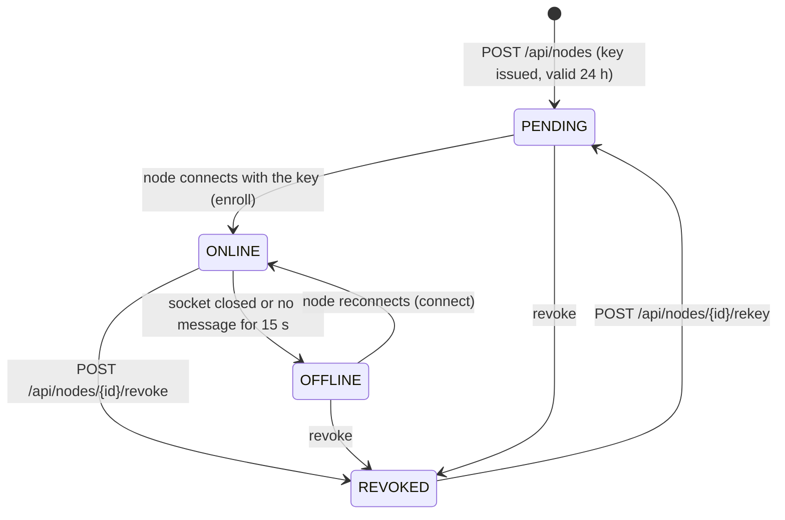
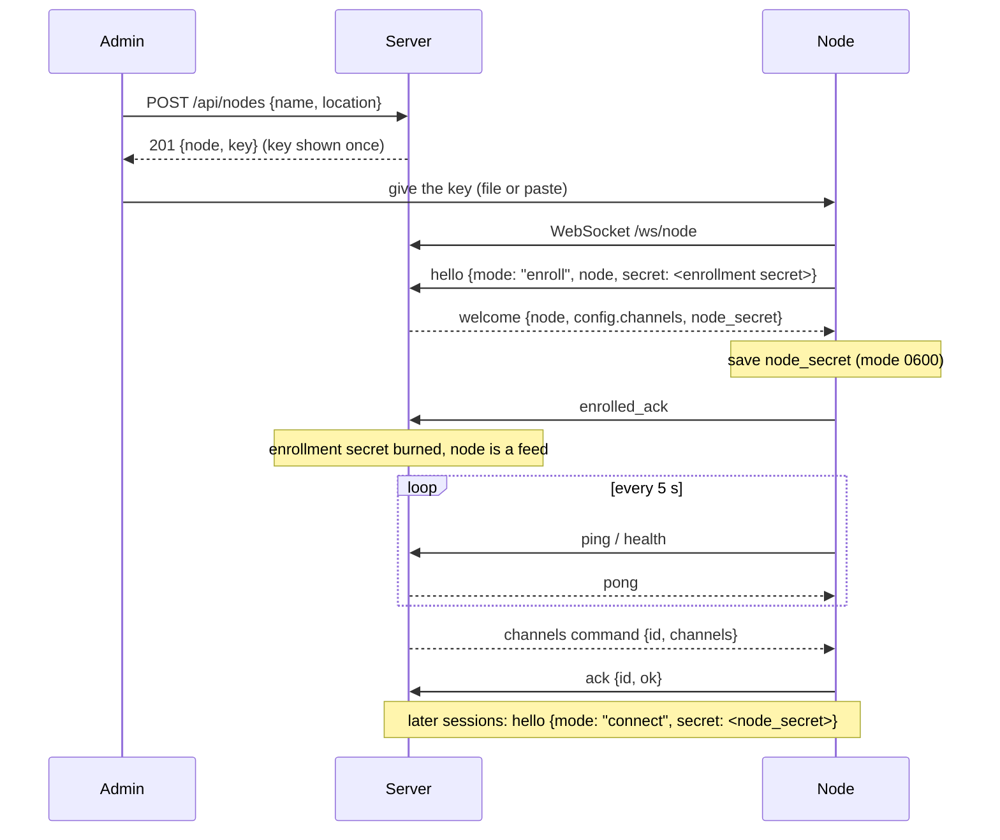

# Nodes

A **node** is a receiver: a Raspberry Pi (or any computer) with an RTL-SDR dongle running the `sdrviz-node` agent.
It sits behind NAT, connects *out* to the server over one WebSocket, does all the radio DSP, and uploads key-ups,
Opus-compressed audio, a spectrum row stream and health. The server decides which AAR channels it decodes.

This page covers how a node is created and enrolled, the node protocol on `/ws/node` (enough to write your own
node), and the admin REST API for managing nodes. The authoritative wire contract in the repository is
`docs/node-protocol.md`; the code is `backend/app/live/node_protocol.py`. Where this page and that file differ,
the differences are listed under [Known differences](#known-differences).

## Lifecycle



| Status | Meaning |
|---|---|
| `PENDING` | Created, never enrolled |
| `ONLINE` | Socket up and a message received in the last 15 s |
| `OFFLINE` | Enrolled, no live socket |
| `REVOKED` | Revoked in Settings; its secrets are deleted and its socket closed |

An enrolled, non-revoked node appears as a feed with id `node-<number>` (for example `node-1`, `driver:
sdrviz-agent`) in `GET /api/feeds` and the live snapshot. Frequencies are assigned to that feed
([rest.md](rest.md#frequencies-and-assignments)); an `assigned` node decodes exactly its enabled assignments.

## Enrollment



### The node key

`POST /api/nodes` (admin) returns the key once:

```json
{
  "node": {"id": "node-49m0vfe5", "number": 1, "feed_id": "node-1", "name": "Test",
           "location": {"lat": 38.9, "lon": -77.0}, "preset": "assigned", "status": "PENDING",
           "link_quality": null, "lag_ms": null, "last_seen": null, "agent_version": null, "health": null,
           "key_expires_at": "2026-11-22T00:21:37+00:00", "created_at": "2026-11-21T00:21:37+00:00"},
  "key": "sdrviz-node1.eyJ1cmwiOiAiaHR0cHM6Ly9zZHIuZXhhbXBsZS5jb20iLCAibm9kZSI6ICJub2RlLTQ5bTB2ZmU1Ii..."
}
```

The key is `sdrviz-node1.` plus base64url (no padding) of this JSON:

```json
{"url": "https://dispatch.andyvwhitman.com", "node": "node-49m0vfe5", "secret": "<enrollment secret>", "v": 1}
```

- `url` is the server's public address (its `SDRVIZ_PUBLIC_URL`). The node derives the socket address from it:
  `https` to `wss`, `http` to `ws`, path `/ws/node`.
- The key is valid for 24 hours and single use. Treat it as a secret.
- Only SHA-256 hashes of secrets are stored. No GET returns a key or secret; `POST /api/nodes` and
  `POST /api/nodes/{id}/rekey` return it once.

The reference agent is run with `sdrviz-node enroll <key|file>` and `sdrviz-node run` (see `receiver/pi/README.md` in
the repository). `tools/fake_node.py --key <key>` is a test node that enrolls and streams Opus tones, spectrum and
health.

## Authentication

`/ws/node` does not use the session cookie or the viewer/admin passwords. The first message must be a `hello`
carrying the node id and a secret: the enrollment secret from the key, or the permanent node secret. Failed
authentications are counted per client address; after too many (the same limiter as logins: 5 per minute) the
server closes with 4429.

## Node protocol (`/ws/node`)

One WebSocket per node: `wss://<server>/ws/node`. Text frames are JSON `{"type": ..., ...}`; unknown fields are
ignored, and an unknown `type` from the server is the node's to handle (the server closes 4400 on a malformed or
unknown message from a node). Binary frames go node to server only. Epoch times (`t`, `peer_t`, `server_time`) are
milliseconds since 1970.

### Handshake

1. Connect. Send `hello` within 10 s (otherwise close 4408).
2. Send `hello`:

   ```json
   {"type": "hello", "protocol": 1, "agent_version": "1.0.0", "node": "node-49m0vfe5",
    "mode": "enroll", "secret": "<secret>"}
   ```

   `mode` is `"enroll"` (secret = enrollment secret) or `"connect"` (secret = permanent node secret).
3. The server answers `welcome` or closes with a code ([below](#close-codes)):

   ```json
   {"type": "welcome", "protocol": 1, "node": {"id": "node-49m0vfe5", "number": 2, "name": "T2"},
    "heartbeat_s": 5, "server_time": 1795220531423, "config": {"channels": [54, 7]},
    "node_secret": "<43-character secret>"}
   ```

   - `node.number` is the 2-byte prefix of every binary frame.
   - `config.channels` is the AAR channel list to decode. It can be `[]` for an `assigned` node with nothing
     assigned yet; keep decoding nothing until a `channels` command arrives.
   - `node_secret` appears only in the answer to an enroll hello.
4. After an enroll, save `node_secret` durably, then send `{"type": "enrolled_ack"}`. The server then burns the
   enrollment secret. If the ack is lost, reconnect with `mode: "connect"` and the new secret: the server treats that
   as the ack. If you never saved it, enroll again with the same key (while it is within 24 h and unburned) to get a
   new `welcome` with a fresh `node_secret`.
5. Both sides may then send any message below at any time.

`protocol` is `1`. A server that does not support it closes with 4426. Within version 1, new optional fields and
message types may appear.

### Heartbeat

Both sides send `{"type": "ping", "t": <epoch ms>}` every 5 s and answer a ping at once with
`{"type": "pong", "t": <copied>, "peer_t": <own epoch ms>}`. RTT is now minus `t`. Any message counts as proof of
life; after 15 s with nothing received the server marks the node OFFLINE and closes the socket (4500), and a node
should do the same to the server and reconnect.

### Node to server (JSON)

| `type` | Fields | Notes |
|---|---|---|
| `key_up` | `ch` (AAR channel), `freq_hz`, `tx_seq`, `t`, `snr_db`, `power_db` | A squelch opened. `tx_seq` is a node-local counter, unique per transmission since the node started; the transmission's audio frames carry it |
| `key_down` | `ch`, `tx_seq`, `t` | The transmission ended |
| `levels` | `t`, `open: [{ch, power_db, snr_db}]` | About every 100 ms while a channel is open (drives level meters) |
| `health` | `t`, `cpu_pct`, `temp_c`, `rtl_tcp` (`connected`, `connecting`, `down`), `dropped_blocks`, `audio_age_ms`, `uptime_s`, `channels`, `tune: {center_hz, rate, gain_db, squelch_db}` | Every 5 s and once right after `welcome` |
| `ack` | `id`, `ok`, `error?: {code, message}` | Exactly one per command. `code`: `bad_value`, `unsupported`, `failed` |
| `enrolled_ack` | none | See handshake |
| `ping`, `pong` | see heartbeat | |

The server stamps key-up start times with its own clock on arrival; the node's `t` in `key_up` is not used for that.
A `key_up` on a channel that is not enabled on this node, or not in the frequency table, is ignored (no event,
audio dropped). Audio for a channel with no accepted key-up is dropped.

### Server to node (JSON commands)

Every command has a string `id`. The node applies it and answers with one `ack` carrying the same `id`.

| `type` | Fields | Effect |
|---|---|---|
| `tune` | `center_hz`, `rate` | Retune the dongle. `rate` is a multiple of 48 000 |
| `gain` | `gain_db` (`null` = automatic) | Tuner gain |
| `squelch` | `squelch_db` | Squelch opens this far above the channel noise floor |
| `channels` | `channels: [AAR numbers]` | Replace the list of decoded channels. The server sends this on connect when the list is non-empty, and whenever assignments, the preset or held listens change. An empty list is never sent |
| `restart` | none | Ack first, then restart the agent |
| `set_server` | `url` (`https://host`) | Test a connection to the new address; if it works, save it and reconnect there. Ack `failed` if the test fails |
| `ping`, `pong` | | |

The server waits 10 s for an ack (30 s for `restart` and `set_server`). Commands are not queued while the node is
offline.

### Binary frames (node to server)

`[node number: 2 bytes big-endian][an inner frame]`. A frame whose number differs from the connection's is dropped.
The inner frames use the same layouts as [live-websocket.md](live-websocket.md#binary-frames) with these differences:

- **Audio** (`kind` 1): `codec` is **1 (Opus)**. The payload is one Opus packet: 8 kHz mono, 20 ms (160 samples),
  about 12 kbit/s. `ch` is the AAR channel, `flags` bit 0 on the first packet and bit 1 on the last of a
  transmission, `offset_ms` the packet's start since the key-up (0, 20, 40, ...). Reset the encoder at key-up. Drop
  audio while offline rather than buffering it.
- **Spectrum** (`kind` 2): 1024 int8 dBFS bins, lowest frequency first, `center_mhz` and `span_mhz` as float32. The
  reference agent sends one row every 200 ms regardless of who watches; the server forwards it only while a browser
  watches the feed.

The server decodes Opus to 8 kHz PCM and re-cuts it into the 100 ms frames that `/ws/live` clients get, writes the
original Opus into the recording, and turns `key_up`, `key_down` and `levels` into the `keyup`, `keydown` and `level`
messages with `feed_id` set to `node-<number>`.

### Overlap, ghosts and gain

- **First key-up wins.** When two receivers hear the same channel, the first key-up owns it until its key-down; the
  other receiver's key-up and audio for that transmission are ignored.
- **Ghost filter.** A key-up weaker than -20 dBFS is held for 0.5 s. If a key-up at least 20 dB stronger on a channel
  within 60 kHz started within 0.5 s of it, the weak one is treated as sideband energy: no `keyup`, no audio, and it
  is counted in `health.ghosts`.
- **Gain guard.** When a key-up or level arrives above -4 dBFS and the node's gain is known, the server sends a
  `gain` command one tuner step lower (floor 20 dB, at most once a minute) and logs a `gain` event.
- **Dropped node.** When the socket closes or the heartbeat is lost, every transmission the node had on air is
  ended with a `keydown`, the status becomes OFFLINE and an `offline` event is logged.

### Close codes

| Code | Meaning | A node should |
|---|---|---|
| 4400 | Malformed or unexpected message | Reconnect with backoff |
| 4401 | Unknown node or wrong secret | Stop; it needs a new key |
| 4403 | Node revoked | Stop; needs a new key |
| 4408 | No `hello` within 10 s | Reconnect |
| 4409 | Replaced by a newer connection of the same node | Reconnect |
| 4410 | Enrollment key expired or already used | Stop; needs a new key |
| 4426 | Protocol version not supported | Stop until updated |
| 4429 | Too many failed attempts from this address | Reconnect with backoff |
| 4500 | Server error, restart, or heartbeat lost | Reconnect |
| 1000, 1001, 1006 | Normal close, going away, network loss | Reconnect |

Reconnect backoff for attempt `n` (0, 1, 2, ...): `min(60, 2^n)` seconds times a random factor between 0.5 and 1.0;
reset `n` to 0 once a connection has stayed up for 30 s. After a "stop" code, keep running and wait for a new key.

## Node REST API

Admin only, all calls (the node list and detail included). Errors are `{"detail": ...}`: 404 unknown node, 409 node
not online, 422 validation.

### The node object

| Field | Type | Notes |
|---|---|---|
| `id` | string | `node-` plus 8 lowercase letters and digits; never reused |
| `number` | int | 1 to 65535, assigned once; the binary frame prefix |
| `feed_id` | string | `node-<number>`; the feed for `watch` and assignments |
| `name` | string | 1 to 40 characters |
| `location` | `{lat, lon}` | lat -90..90, lon -180..180 |
| `preset` | string | `assigned` (default) or `aar` |
| `status` | string | `PENDING`, `ONLINE`, `OFFLINE`, `REVOKED` |
| `link_quality` | int or null | 0 to 100, only while ONLINE. 40% round-trip time (100 at or under 100 ms, 0 at 2000 ms), 40% missed heartbeats, 20% reconnects in the last hour, over a 60 s window |
| `lag_ms` | int or null | Only while ONLINE: half the median RTT plus `audio_age_ms` |
| `last_seen` | ISO string or null | Last message |
| `agent_version` | string or null | From the last hello |
| `health` | object or null | The last `health` message, plus server-added `peak_dbfs`, `fault` and `ghosts`; null until the first one since the server started |
| `key_expires_at` | ISO string or null | While an enrollment key is outstanding |
| `created_at` | ISO string | |

Presets: `assigned` makes the node decode the AAR channels of its **enabled assignments** (plus any held listens);
`aar` makes it decode the whole band, AAR 7 to 97, and the server still only shows and records enabled frequencies.

### Calls

| Call | Body | Returns |
|---|---|---|
| `GET /api/nodes` | | Array of nodes, ordered by number |
| `POST /api/nodes` | `{name, location: {lat, lon}, preset?}` | `201 {node, key}` |
| `GET /api/nodes/{id}` | | Node plus `events`: the last 50, newest first (`{t, kind, detail}`; `kind` is `enrolled`, `online`, `offline`, `reconnect`, `rekeyed`, `revoked`, `command`, `gain`, `fault`, `error`) |
| `PATCH /api/nodes/{id}` | any of `name`, `location`, `preset` | Node. A preset change sends an online node a new `channels` command; an offline node gets the list in its next `welcome`. 422 for an unknown preset |
| `POST /api/nodes/{id}/rekey` | none | `{node, key}`: a new 24 h enrollment key. The old node secret keeps working until the new enrollment completes. On a revoked node it makes it PENDING again |
| `POST /api/nodes/{id}/revoke` | none | Node (REVOKED). Secrets are deleted and the socket closed with 4403. Revoking twice is a no-op. There is no delete |
| `POST /api/nodes/{id}/commands` | a command | `CommandResult` |

### Commands

```sh
curl -b cookies.txt -X POST -H 'Content-Type: application/json' \
  -d '{"type": "gain", "gain_db": 32.8}' \
  https://dispatch.andyvwhitman.com/api/nodes/node-49m0vfe5/commands
```

| Body | Validation |
|---|---|
| `{"type": "tune", "center_hz", "rate"}` | `center_hz` 24 000 000 to 1 766 000 000; `rate` positive, at most 3 200 000, a multiple of 48 000 |
| `{"type": "gain", "gain_db"}` | 0 to 50, or `null` for automatic |
| `{"type": "squelch", "squelch_db"}` | 0 to 40 |
| `{"type": "channels", "channels": [..]}` | 1 to 255 integers, each 1 to 255 |
| `{"type": "restart"}` | |
| `{"type": "set_server", "url"}` | `http(s)://host`, optional trailing slash |

Response, `200`:

```json
{"id": "c12", "type": "gain", "status": "acked", "error": null}
```

`status` is `acked`, `failed` (with `error: {code, message}`) or `timeout`. A command to a node that is not ONLINE is
`409 {"detail": "Node is not online"}`. Every command is added to the node's events.

## Known differences

- `docs/node-protocol.md` says the only preset is `aar`. The code has two: `assigned` (the default) and `aar`.
- That file says `GET /api/nodes` is readable by any session ("behind the session cookie"); in the code the whole
  `/api/nodes` router is admin only.
- That file says the server ignores node message types it does not know. In the code an unknown or malformed
  message from a node closes the socket with 4400 (the parser rejects unknown `type`s), so a node must not send
  types outside the list above.
- The node object's `health` also carries `ghosts` (the ghost filter's per-channel counts) and the server-added
  `peak_dbfs` and `fault`.
